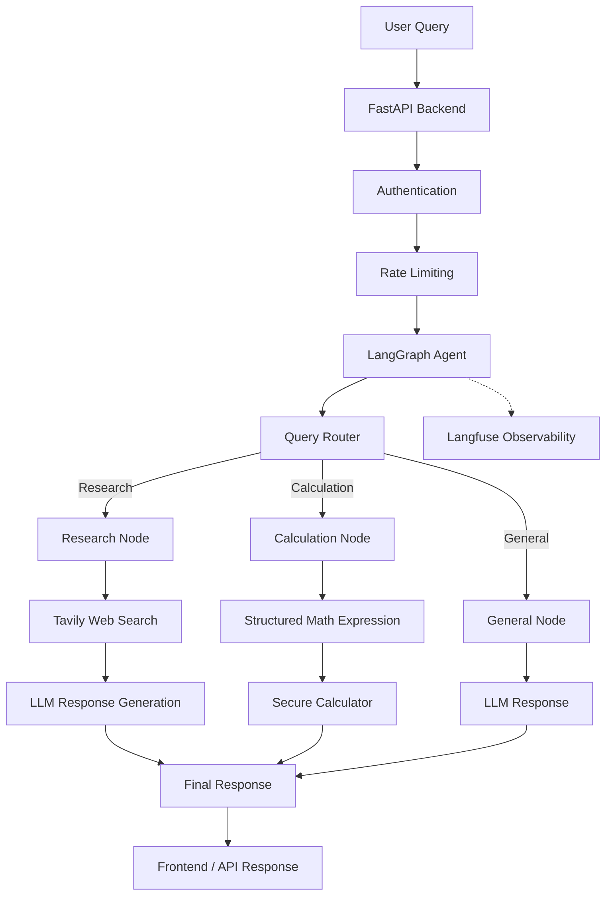

# AetherAI — AI Research Agent

AetherAI is an AI-powered research assistant built with Python, LangChain, and LangGraph. It can understand user queries, intelligently route them to specialized workflows, perform web research, execute mathematical calculations, and generate contextual responses.

The project demonstrates practical AI engineering concepts, including agent orchestration, tool calling, structured outputs, streaming responses, API development, observability, and automated testing.

---

## Project Overview

AetherAI uses an agent-based architecture to handle different categories of user queries.

Instead of sending every query directly to an LLM, the system first classifies the request and routes it to the appropriate processing node.

### Core Capabilities

- **Intelligent Query Routing:** Classifies incoming queries into research, calculation, or general categories.
- **Web Research:** Uses Tavily to retrieve relevant information from the web.
- **Mathematical Calculations:** Executes mathematical expressions using a secure, AST-based calculator.
- **LLM-Powered Responses:** Uses GPT-4.1-mini to generate contextual responses.
- **Streaming Responses:** Streams generated content to the frontend using Server-Sent Events (SSE).
- **FastAPI Backend:** Exposes REST API endpoints for interacting with the agent.
- **API Key Authentication:** Protects API endpoints using API key-based authentication.
- **Rate Limiting:** Uses SlowAPI to control API request frequency.
- **Conversation State Management:** Uses LangGraph state management and checkpointing.
- **Observability:** Integrates Langfuse for monitoring LLM calls, agent execution, and workflows.
- **Automated Testing:** Uses pytest to validate tools, graph nodes, and end-to-end workflows.
- **Interactive Frontend:** Provides a lightweight web interface for submitting queries and viewing responses.

---

## Architecture

AetherAI follows a graph-based agent architecture implemented using LangGraph.

### High-Level Workflow



### Workflow Explanation

**1. User Query**

The user submits a question through the web interface or API.

**2. Query Routing**

The router uses structured output to classify the query into one of three categories:

- `research`
- `calculation`
- `general`

**3. Specialized Processing**

Depending on the classification, LangGraph executes the corresponding node.

| Node | Responsibility |
|---|---|
| Router | Determines the query category |
| Research | Retrieves web information and generates an answer |
| Calculation | Extracts a mathematical expression and evaluates it |
| General | Handles general conversational queries |

**4. Response Generation**

The selected workflow generates a response and updates the graph state.

**5. Streaming**

The streaming API sends generated content incrementally to the frontend using Server-Sent Events.

**6. Observability**

Langfuse captures execution traces, LLM interactions, and workflow information.

---

## Technology Stack

| Category | Technologies |
|---|---|
| Programming Language | Python |
| LLM | OpenAI GPT-4.1-mini |
| Agent Framework | LangChain |
| Agent Orchestration | LangGraph |
| Web Search | Tavily |
| Backend | FastAPI |
| Streaming | Server-Sent Events (SSE) |
| Authentication | API Key Authentication |
| Rate Limiting | SlowAPI |
| Observability | Langfuse |
| Data Validation | Pydantic |
| Retry Mechanism | Tenacity |
| Testing | pytest |
| Frontend | HTML, CSS, JavaScript |
| Dependency Management | uv |
| Version Control | Git and GitHub |
| CI | GitHub Actions |

---

## Project Structure

```text
ai_research_agent/
│
├── .github/
│   └── workflows/
│       └── ci.yml
│
├── static/
│   └── index.html
│
├── tests/
│   ├── test_graph.py
│   ├── test_tools.py
│   └── test_workflow.py
│
├── api.py
├── config.py
├── graph.py
├── langfuse_client.py
├── main.py
├── tools.py
│
├── .env
├── .gitignore
├── pyproject.toml
├── requirements.txt
├── uv.lock
└── README.md
```

### Important Files

- `graph.py` – Defines the LangGraph workflow, state, routing logic, and processing nodes.
- `tools.py` – Contains web search and secure mathematical calculation tools.
- `api.py` – Implements FastAPI endpoints, authentication, rate limiting, and streaming.
- `config.py` – Manages application configuration.
- `langfuse_client.py` – Initializes Langfuse observability.
- `main.py` – Provides an entry point for running the agent directly.
- `static/index.html` – Contains the interactive frontend.
- `tests/` – Contains unit and workflow tests.

---

## Getting Started

### Prerequisites

Install the following:

- Python 3.13+
- uv package manager
- Git
- Docker Desktop (for containerization)
- OpenAI API key
- Tavily API key
- Langfuse account (optional, for observability)

### 1. Clone the Repository

```bash
git clone https://github.com/Acrenox/AetherAI.git

cd AetherAI
```

### 2. Create a Virtual Environment

```bash
uv sync
```

This installs the project dependencies using the lockfile.

### 3. Configure Environment Variables

Create a `.env` file in the project root.

```env
OPENAI_API_KEY=your_openai_api_key
TAVILY_API_KEY=your_tavily_api_key

LANGFUSE_PUBLIC_KEY=your_langfuse_public_key
LANGFUSE_SECRET_KEY=your_langfuse_secret_key
LANGFUSE_BASE_URL=your_langfuse_host
```

Configure the API authentication key using the environment variable expected by `config.py` and `api.py`.

**Important:** Never commit your `.env` file or expose API keys in source code.

### 4. Run the Application

Start the FastAPI server:

```bash
uv run uvicorn api:app --reload
```

Open the application:

```text
http://127.0.0.1:8000
```

API documentation:

```text
http://127.0.0.1:8000/docs
```

---

## API Endpoints

| Method | Endpoint | Description |
|---|---|---|
| GET | `/` | Serves the frontend |
| GET | `/health` | Application health check |
| POST | `/ask` | Processes a query and returns a response |
| POST | `/ask/stream` | Processes a query and streams the response |

### Example Request

```http
POST /ask
Content-Type: application/json
```

```json
{
  "query": "What is the difference between RAG and fine-tuning?"
}
```

The endpoint requires the configured API key authentication header.

### Streaming API

The `/ask/stream` endpoint uses Server-Sent Events.

It sends incremental response tokens to the frontend and a final event containing the completed response and query metadata.

This allows users to see responses as they are generated instead of waiting for the entire response.

---

## Security and Reliability

AetherAI incorporates several safeguards:

**API Authentication**

API key authentication restricts access to protected endpoints.

**Rate Limiting**

SlowAPI helps prevent excessive API requests.

**Secure Calculator**

The calculator uses Python's Abstract Syntax Tree (AST) to parse and evaluate supported mathematical expressions.

It avoids unrestricted `eval()` execution and only permits explicitly supported mathematical operations.

**Retry Mechanism**

Tenacity provides retry handling for transient web-search failures.

**Environment Configuration**

Sensitive API credentials are loaded through environment variables rather than hardcoded in the application.

---

## Observability with Langfuse

Langfuse is integrated to monitor the execution of the agent.

It helps track:

- Agent execution traces.
- Router decisions.
- LLM calls.
- Tool execution.
- Workflow latency.
- Errors during execution.

This provides visibility into the internal behavior of the application and helps with debugging and performance analysis.

---

## Testing

The project uses pytest for automated testing.

Run the complete test suite:

```bash
uv run python -m pytest -v
```

### Test Coverage

| Test File | Purpose |
|---|---|
| `test_graph.py` | Validates individual LangGraph nodes |
| `test_tools.py` | Tests web search and calculator tools |
| `test_workflow.py` | Tests complete agent workflows |

The current test suite contains **12 passing tests**.

Tests use mocked dependencies where appropriate to avoid unnecessary external API calls.

---

## Continuous Integration

GitHub Actions is configured to run automated tests when code changes are pushed to the repository.

The CI workflow helps ensure that changes do not break existing functionality.

The project is also being prepared for Docker-based deployment and continuous delivery.

---

## Future Enhancements

AetherAI is an evolving AI engineering project. Planned enhancements include:

- Multi-agent architecture.
- Specialized research and analysis agents.
- MCP (Model Context Protocol) integration.
- Advanced agent orchestration using LangGraph.
- Structured response generation across all agent nodes.
- Improved RAG integration.
- Docker containerization.
- Cloud deployment using Azure Container Registry and Azure Container Apps.
- Continuous deployment through GitHub Actions.
- Enhanced evaluation and monitoring.

---

## Learning Objectives

This project is designed to demonstrate practical implementation of:

- LLM integration and prompt engineering.
- Tool calling and structured outputs.
- Agent orchestration with LangGraph.
- Conditional routing and state management.
- API development with FastAPI.
- Real-time streaming with SSE.
- LLM observability with Langfuse.
- Secure tool execution.
- Automated testing and CI/CD.
- Production-oriented AI application design.

---

## Author

**AetherAI** is an evolving AI engineering playground focused on building intelligent agents, multi-agent systems, RAG pipelines, LLM integrations, and autonomous workflows using Python and modern AI technologies.

**GitHub:** https://github.com/Acrenox/AetherAI
